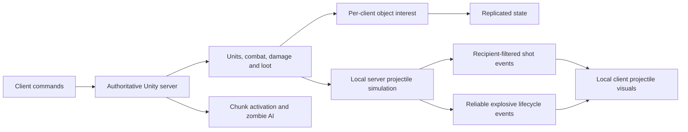

# Just Scavenge — Multiplayer Systems

**Survive. Scavenge. Return.**

A top-down co-op zombie survival game built in Unity with Netcode for
GameObjects and PlayFab dedicated servers. Deploy a squad of survivors from your
home base, scavenge an open neighborhood, fight through zombie hordes, and bring
the loot home.

This repository is the project's engineering portfolio: selected C# source from
the private game, focused on server-authoritative combat, per-client
replication, scalable zombie simulation, and compact network protocols. The full
Unity project, art, audio, and backend services remain private.


<sub>An online session: deploying from the home base, finding a mission server,
and fighting zombie hordes. The panel at the top left is the live network
overlay, showing roughly 90–115 ms round trip to the server.</sub>

## Highlights

- **Server-authoritative co-op.** Dedicated Linux servers on PlayFab Multiplayer
  Servers resolve movement, targeting, combat, damage, inventory, and loot.
  Clients send commands and present the results.
- **No network object per bullet.** The server simulates projectiles locally and
  sends compact, recipient-filtered shot batches that clients replay as visuals.
  Sixteen ordinary shots fit in 254 payload bytes instead of 1,156.
- **Each player receives only what their squad can reach.** Per-client network
  interest replicates zombies, loot, shots, and explosions only around that
  player's living survivors.
- **Simulation follows the players, not the map.** Only chunks near survivors are
  active. Distant zombies go dormant, idle zombies at the edge decide less often,
  and hordes share one cached flow field.
- **No spawn spikes.** A shared per-frame creation budget replaced single frames
  that built 49–51 zombies and took 64–71 ms on the server.
- **A lean dedicated server.** Visual-only zombie content is stripped from server
  builds, cutting each server zombie from 91 GameObjects to 1.

## Gameplay

https://github.com/user-attachments/assets/2cb66ee2-95bf-4b0e-9161-4768dece1be6

<table>
  <tr>
    <td width="50%"></td>
    <td width="50%"></td>
  </tr>
  <tr>
    <td align="center"><sub>Explosive weapons</sub></td>
    <td align="center"><sub>Field inventory and item stats</sub></td>
  </tr>
  <tr>
    <td width="50%"></td>
    <td width="50%"></td>
  </tr>
  <tr>
    <td align="center"><sub>Home base storage</sub></td>
    <td align="center"><sub>Deployment board</sub></td>
  </tr>
</table>

- **Squad control.** Click or drag to select up to three survivors, click to
  move along previewed paths, and let them engage zombies within weapon range.
- **Combat.** Rifles, shotguns, pistols, a crossbow, melee weapons, and rockets,
  with damage numbers, critical hits, hit reactions, and ragdoll deaths. Gunfire
  alerts nearby zombies, which converge as a horde.
- **Scavenging.** Highlighted loot containers, a pickup feed, and a squad-wide
  field inventory for equipping, using, and salvaging items from Common to
  Legendary.
- **Home base.** A private city block with storage, loadouts, and a deployment
  board for choosing the squad and the next expedition across three maps.
- **Online co-op.** Each player brings their own squad to a dedicated mission
  server, with in-game chat, fog of war, and a minimap radar.

## Engineering

### Where to start

| Engineering area | Starting point | What the sample demonstrates |
|---|---|---|
| Authoritative combat | [Combat.cs](Combat/Combat.cs) | Server attack decisions, weapon state, and projectile launch data |
| Projectile replication | [ProjectilePool.cs](Combat/ProjectilePool.cs) | Local simulation with recipient-filtered visual event batches |
| Compact protocols | [ProjectileShotCodec.cs](Networking/ProjectileShotCodec.cs) | Versioned encoding, quantization, fallbacks, and strict decoding |
| Network interest | [NetworkInterestManager.cs](Networking/NetworkInterestManager.cs) | Per-client visibility around living squad members |
| Zombie simulation | [ZombieChunkManager.cs](Optimization/ZombieChunkManager.cs) | Activation, dormancy, snapshot restoration, and spawn eligibility |
| Shared navigation | [ZombieFlowFieldManager.cs](Optimization/ZombieFlowFieldManager.cs) | Shared horde directions over cached NavMesh topology |
| Spawn pacing | [ZombieSpawnScheduler.cs](Optimization/ZombieSpawnScheduler.cs) | A shared creation budget for fresh spawns and restoration |
| World loot | [LootSocketManager.cs](Loot/LootSocketManager.cs) | Weighted chunk activation and timed restocking |

### Architecture



The server resolves gameplay. Clients submit commands and present replicated
state and cosmetic events. Simulation activation and network visibility are
separate decisions: a zombie can remain active on the server while a particular
remote client receives no copy of it.

### Combat without a network object for every bullet

[Projectile.cs](Combat/Projectile.cs) is a local `MonoBehaviour` with authority
and visual-only modes. Server projectiles resolve hits, damage, piercing,
bouncing, and split children. Clients replay visual trajectories; those visual
collisions do not decide damage.

[ProjectilePool.cs](Combat/ProjectilePool.cs) sends ordinary shots through the
V2 compact codec with `UnreliableSequenced` delivery. Each packet carries its own
origin, so playback does not depend on a previous packet. Position, direction,
speed, and lifetime use compact representations where possible; explicit
fallbacks retain values that do not fit. Invalid batches are rejected before
partial playback.

[ProjectileInterestUtility.cs](Networking/ProjectileInterestUtility.cs) includes
potentially incoming trajectories when selecting recipients. Filtering happens
before the shared batch origin is encoded. Hidden ignored-target identifiers
are omitted for each recipient.

Explosive projectiles use a separate reliable launch/termination channel in
[ProjectilePool.Explosions.cs](Combat/ProjectilePool.Explosions.cs) and
[ExplosiveProjectileCodec.cs](Networking/ExplosiveProjectileCodec.cs).
[ExplosionResolver.cs](Combat/ExplosionResolver.cs) resolves server blast damage and cover;
[ExplosionPresentation.cs](Combat/ExplosionPresentation.cs) handles client blast effects.

[ProjectileVisualConfig.cs](Combat/ProjectileVisualConfig.cs) and its
[registry](Combat/ProjectileVisualRegistry.cs) select presentation independently
of gameplay. [ProjectileTrailPool.cs](Combat/ProjectileTrailPool.cs) lets trails
finish fading after bullets return to their pool. Authority projectiles do not
render, including when running as a host.

### Replicate the world each squad needs

[NetworkInterestManager.cs](Networking/NetworkInterestManager.cs) considers the
union of a client's living survivor areas. Separate entry and exit distances
reduce repeated hide/show at boundaries. Owned survivors remain visible to their
owner, private inventory follows an owner-only policy, and zombies and loot use
spatial visibility.

[Unit.cs](Unit/Unit.cs), [PlayerUnit.cs](Unit/PlayerUnit.cs), and
[Combat.cs](Combat/Combat.cs) separate public presentation from private state.
Ordinary cosmetic hit effects are compacted with
[HitEffectCodec.cs](Networking/HitEffectCodec.cs); lethal hit feedback travels
with reliable death state. Losing a cosmetic packet does not undo server damage.

### Activate nearby simulation and share navigation work

[ZombieChunkManager.cs](Optimization/ZombieChunkManager.cs) tracks active chunks
around living survivors. Dormant zombies stop AI and movement work. Fresh spawn
eligibility also excludes a configurable ring around every survivor, while
saved zombies can restore inside the active area.

[ZombieSpawnScheduler.cs](Optimization/ZombieSpawnScheduler.cs) shares a creation
and attempt budget between [spawners](Optimization/ZombieSpawner.cs) and snapshot
restoration. Idle zombies at the outer active ring use slower decisions; target
searches can be skipped when their detection reach cannot cross the minimum
chunk separation. Alerts and valid targets restore normal decision scheduling.

[ZombieFlowFieldManager.cs](Optimization/ZombieFlowFieldManager.cs) caches the
expensive NavMesh topology and rebuilds dynamic costs for shared horde movement.
Its flow-field eligibility check still scans propagation origins; it is not a
constant-time lookup.

[ZombieSyncManager.cs](Optimization/ZombieSyncManager.cs) now preserves existing
scene references by creating the chunk and flow-field managers. The former
three-tier distance LOD system is no longer its implementation.

### Loot can restock while players stay nearby

[LootSocketManager.cs](Loot/LootSocketManager.cs) selects weighted sockets per
active chunk and tracks depletion with chunk-level timestamps. Depleted active
chunks can refill once their timer expires, including occupied chunks. Inactive
chunks keep their timestamp and refill when activated if due.
[LootContainer.cs](Loot/LootContainer.cs) also maintains a server-owned looting
lock so two units cannot process the same container concurrently.

Chunk activation controls simulation and loot availability. It does **not**
stream map geometry out of memory.

## Results

Recorded during development in the private project. The captures, profiling
builds, and test projects are not part of this repository, so these figures are
evidence of the work rather than reproducible benchmarks.

| Change | Recorded result | Kind of evidence |
|---|---|---|
| Shared zombie creation budget | Worst server frames 64–71 ms before; 33.5–34.5 ms after, close to the 30 FPS cap | Separate hosted captures, not a controlled A/B |
| Compact shot batches | 16 ordinary shots: 1,156 → 254 payload bytes (78% smaller) | Format arithmetic and byte-layout tests; excludes network headers |
| Compact hit-effect batches | 26 / 35 / 44 / 53 payload bytes for 1–4 hits | Byte-layout tests; excludes network headers |
| Server-only zombie content | 91 → 1 GameObjects and 31 → 0 renderers per server zombie | Packed prefab counts; no CPU figure |
| Server frame pacing | Held the 30 FPS cap; frame work averaged 3.1 ms (p95 4.7 ms) | One 60-second gameplay capture on one map |
| Per-client network interest | 0.05–0.07 ms per server frame; bandwidth saving not measured | Stationary three-survivor captures |

Live latency, packet loss, and large-horde performance require testing with
matching client/server builds and representative scenes.

## Technology and tuning

The source project uses Unity **6000.4.4f1**, Universal Render Pipeline **17.4.0**,
Netcode for GameObjects **2.11.0**, AI Navigation **2.0.12**, and the Input System.
Its online infrastructure uses PlayFab authentication and Multiplayer Servers,
the PlayFab GSDK, Azure Functions, and Linux server containers. Server startup,
connection handling, deployment, and backend code are not included here.

See [current tuning](docs/current-tuning.md) for the serialized settings behind
this snapshot. Unity assets can override C# field initializers, so the scripts'
defaults alone do not establish effective gameplay values.

## Snapshot and scope

**Source snapshot: October 28, 2026.** Every exported file matches private
commit `ce09667c7`. [SOURCE_SNAPSHOT.json](SOURCE_SNAPSHOT.json) records each
file's original path, LF-normalized SHA-256 hash, and that source revision. The
files are exported without rewriting their gameplay implementation. This is a
source snapshot, not a claim that every change is in a shipped client or hosted
server.

**This is a code portfolio, not a standalone Unity project.** It omits scenes,
prefabs, ScriptableObject instances, art/audio, package setup, backend services,
server startup and connection handling, and supporting game systems such as
inventory, profiles, weapons, and status effects. The selected scripts reference those dependencies and will not compile
as a complete game on their own. Deployment configuration is not included.

### Check the exported snapshot

Run the verifier from this repository with Python 3:
```sh
python tools/verify_snapshot.py
```

It checks published samples against the manifest after normalizing line endings.
With access to the source project, also compare the original files:
```sh
python tools/verify_snapshot.py --source-root "path/to/source/project"
```

Hash agreement verifies the export's identity; it does not compile the omitted Unity project or validate a multiplayer release.

## License

Published source is licensed under [GPL-3.0](LICENSE).
