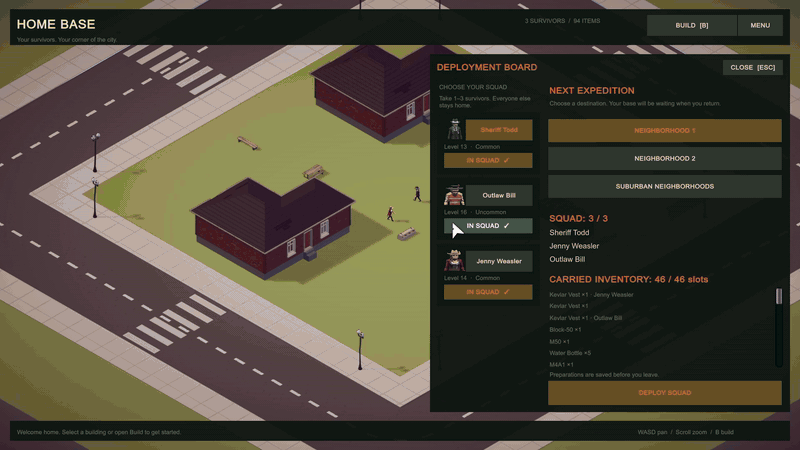
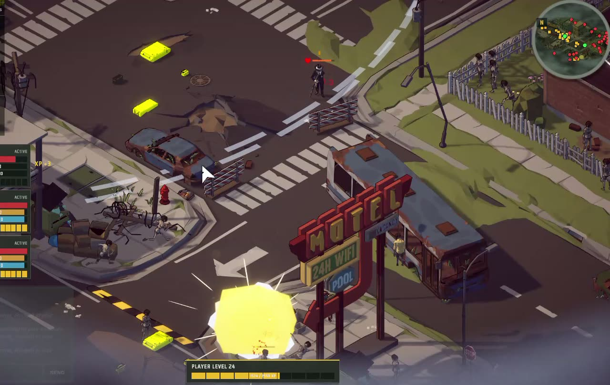
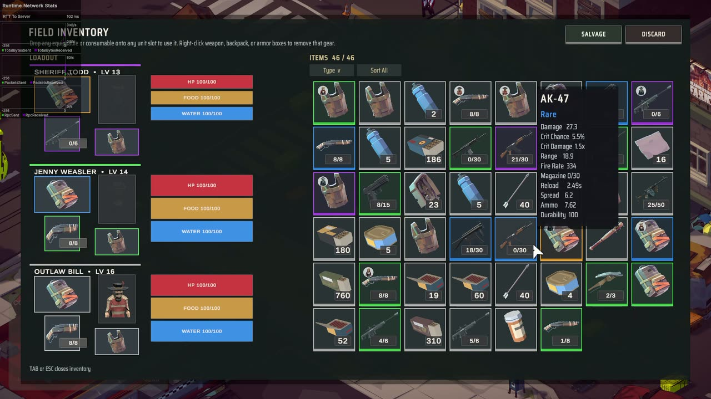
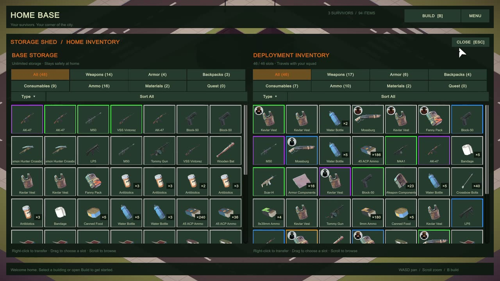
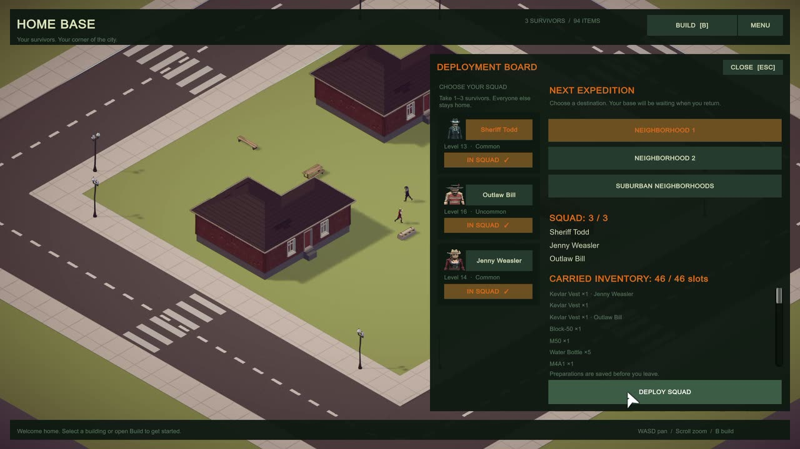
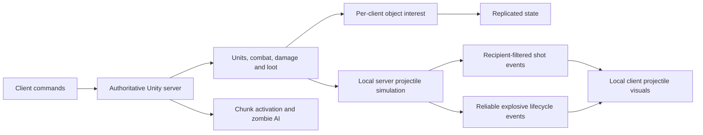

# Just Scavenge — Multiplayer Systems

**Survive. Scavenge. Return.**

A top-down co-op zombie survival game built in Unity with Netcode for
GameObjects and PlayFab dedicated servers. Deploy a squad of survivors from your
home base, scavenge an open neighborhood, fight through zombie hordes, and bring
the loot home.

This repository is a case study of the engineering behind the game. Just
Scavenge is headed for commercial release, so its source code, assets, and
services are private. This page describes the architecture and results and
shows a few short excerpts; full source is available privately to reviewers on
request.



<sub>An online session: deploying from the home base, finding a mission server,
and fighting zombie hordes. The panel at the top left is the live network
overlay, showing roughly 90–115 ms round trip to the server.</sub>

## Highlights

- **Server-authoritative co-op.** Dedicated Linux servers on PlayFab Multiplayer
  Servers resolve movement, targeting, combat, damage, inventory, and loot.
  Clients send commands and present the results.
- **No network object per bullet.** The server simulates projectiles locally and
  sends compact, recipient-filtered shot batches that clients replay as visuals.
  Sixteen ordinary shots fit in 254 payload bytes instead of 1,156.
- **Each player receives only what their squad can reach.** Per-client network
  interest replicates zombies, loot, shots, and explosions only around that
  player's living survivors.
- **Simulation follows the players, not the map.** Only chunks near survivors are
  active. Distant zombies go dormant, idle zombies at the edge decide less often,
  and hordes share one cached flow field.
- **No spawn spikes.** A shared per-frame creation budget replaced single frames
  that built 49–51 zombies and took 64–71 ms on the server.
- **A lean dedicated server.** Visual-only zombie content is stripped from server
  builds, cutting each server zombie from 91 GameObjects to 1.

## Gameplay

https://github.com/user-attachments/assets/2cb66ee2-95bf-4b0e-9161-4768dece1be6

<table>
  <tr>
    <td width="50%"></td>
    <td width="50%"></td>
  </tr>
  <tr>
    <td align="center"><sub>Explosive weapons</sub></td>
    <td align="center"><sub>Field inventory and item stats</sub></td>
  </tr>
  <tr>
    <td width="50%"></td>
    <td width="50%"></td>
  </tr>
  <tr>
    <td align="center"><sub>Home base storage</sub></td>
    <td align="center"><sub>Deployment board</sub></td>
  </tr>
</table>

- **Squad control.** Click or drag to select up to three survivors, click to
  move along previewed paths, and let them engage zombies within weapon range.
- **Combat.** Rifles, shotguns, pistols, a crossbow, melee weapons, and rockets,
  with damage numbers, critical hits, hit reactions, and ragdoll deaths. Gunfire
  alerts nearby zombies, which converge as a horde.
- **Scavenging.** Highlighted loot containers, a pickup feed, and a squad-wide
  field inventory for equipping, using, and salvaging items from Common to
  Legendary.
- **Home base.** A private city block with storage, loadouts, and a deployment
  board for choosing the squad and the next expedition across three maps.
- **Online co-op.** Each player brings their own squad to a dedicated mission
  server, with in-game chat, fog of war, and a minimap radar.

## Engineering

### Architecture



The server resolves gameplay. Clients submit commands and present replicated
state and cosmetic events. Simulation activation and network visibility are
separate decisions: a zombie can remain active on the server while a particular
remote client receives no copy of it.

### Combat without a network object for every bullet

Projectiles are plain local components with authority and visual-only modes.
Server projectiles resolve hits, damage, piercing, bouncing, and split children;
clients replay visual trajectories whose collisions never decide damage.

Ordinary shots travel in versioned batches with `UnreliableSequenced` delivery.
Each batch carries its own origin, so playback never depends on an earlier
packet. Positions become centimetre offsets from that origin, directions become
16-bit yaw and pitch, and optional fields are written only when flagged, with
full-precision fallbacks for values that do not fit. Clients validate a whole
batch before playing any of it, and recipients are filtered before encoding.
Explosives use a separate reliable launch and detonation channel.

```csharp
private static void WriteEvent(FastBufferWriter writer, in ShotEventData shot, Vector3 origin, Flags flags)
{
    writer.WriteValueSafe((byte)flags);
    if ((flags & Flags.FullOrigin) != 0)
        writer.WriteValueSafe(shot.OriginPosition);
    else
        for (int i = 0; i < 3; i++)
            writer.WriteValueSafe((short)Math.Round(((double)shot.OriginPosition[i] - origin[i]) * 100d));

    Vector3 direction = shot.Direction.normalized;
    double yaw = Math.Atan2(direction.x, direction.z);
    if (yaw < 0d) yaw += Math.PI * 2d;
    double pitch = Math.Atan2(direction.y, Math.Sqrt((double)direction.x * direction.x + (double)direction.z * direction.z));
    writer.WriteValueSafe((ushort)((int)Math.Round(yaw * 65536d / (Math.PI * 2d)) & 0xffff));
    writer.WriteValueSafe((ushort)Math.Round((pitch + Math.PI / 2d) * ushort.MaxValue / Math.PI));

    WriteScalar(writer, shot.Velocity, 100d, (flags & Flags.FullVelocity) != 0);
    WriteScalar(writer, shot.Lifetime, 1000d, (flags & Flags.FullLifetime) != 0);
    // ... pierce, bounce, ignored-target, and visual fields follow only when flagged.
}
```

### Replicate the world each squad needs

Each client's interest is the union of circles around its living survivors.
Objects enter at one radius and leave at a larger one, so they do not flicker
in and out at the boundary. Owned survivors stay visible to their owner, private
inventory is owner-only, and zombies and loot use spatial visibility. Private
player state replicates only to its owner, and lethal hit feedback travels with
the reliable death state, so losing a cosmetic packet never undoes server damage.

```csharp
private bool ShouldObserve(NetworkObject entity, NetworkInterestPolicy policy, ulong clientId, ClientInterest interest)
{
    if (policy != NetworkInterestPolicy.Spatial && entity.OwnerClientId == clientId)
        return true;
    if (policy == NetworkInterestPolicy.OwnerOnly)
        return false;

    float radius = entity.IsNetworkVisibleTo(clientId) ? HideRadius : ShowRadius;
    Vector3 position = entity.transform.position;
    foreach (Vector3 anchor in interest.Anchors)
        if (SquaredDistanceXZ(position, anchor) <= radius * radius)
            return true;
    return false;
}
```

### Activate nearby simulation and share navigation work

The world is divided into chunks, and only those near living survivors are
active. Dormant zombies stop AI and movement work, idle zombies in the outer ring
decide less often, and target searches are skipped when a zombie's detection
range cannot reach a survivor's chunk. Fresh spawns avoid a ring around every
survivor, while saved zombies can restore inside the active area. Untargeted
hordes follow one shared flow field built over cached NavMesh topology.

Fresh spawns and restorations share one per-frame creation budget, with saved
populations first and a soft time limit between attempts:

```csharp
public void ProcessFrame(int frame, int maxCreations, int maxAttempts, double maxMilliseconds)
{
    if (_lastFrame == frame) return;
    _lastFrame = frame;
    LastFrameCreations = 0;
    LastFrameAttempts = 0;
    double started = _milliseconds();
    while (_queued.Count > 0 && LastFrameCreations < maxCreations && LastFrameAttempts < maxAttempts)
    {
        // A single creation is indivisible. Always permit the first attempt to make progress.
        if (LastFrameAttempts > 0 && _milliseconds() - started >= maxMilliseconds) break;
        Queue<IZombieSpawnWork> queue = _restores.Count > 0 ? _restores : _fresh;
        IZombieSpawnWork source = queue.Dequeue();
        LastFrameAttempts++; // Includes stale/cancelled entries and failed position searches.
        try
        {
            if (source.HasPendingSpawn && source.TrySpawnOne()) LastFrameCreations++;
        }
        finally
        {
            // Keep membership during callbacks so re-enqueueing cannot duplicate this source.
            if (source.HasPendingSpawn) queue.Enqueue(source);
            else _queued.Remove(source);
        }
    }
}
```

### Loot that restocks while players stay nearby

Loot sockets activate per chunk by weighted selection, and each depleted chunk
tracks a single restock timestamp. Active chunks refill when their timer
expires, even with survivors nearby, and a server-owned looting lock stops two
units from processing the same container. Chunk activation controls simulation
and loot; it does not stream map geometry out of memory.

## Results

Recorded during development in the private project. The captures, profiling
builds, and tests are private, so these figures are evidence of the work rather
than reproducible benchmarks.

| Change | Recorded result | Kind of evidence |
|---|---|---|
| Shared zombie creation budget | Worst server frames 64–71 ms before; 33.5–34.5 ms after, close to the 30 FPS cap | Separate hosted captures, not a controlled A/B |
| Compact shot batches | 16 ordinary shots: 1,156 → 254 payload bytes (78% smaller) | Format arithmetic and byte-layout tests; excludes network headers |
| Compact hit-effect batches | 26 / 35 / 44 / 53 payload bytes for 1–4 hits | Byte-layout tests; excludes network headers |
| Server-only zombie content | 91 → 1 GameObjects and 31 → 0 renderers per server zombie | Packed prefab counts; no CPU figure |
| Server frame pacing | Held the 30 FPS cap; frame work averaged 3.1 ms (p95 4.7 ms) | One 60-second gameplay capture on one map |
| Per-client network interest | 0.05–0.07 ms per server frame; bandwidth saving not measured | Stationary three-survivor captures |

Live latency, packet loss, and large-horde performance require testing with
matching client/server builds and representative scenes.

## Technology

Unity **6000.4.4f1**, Universal Render Pipeline **17.4.0**, Netcode for
GameObjects **2.11.0**, AI Navigation **2.0.12**, and the Input System. Online
services use PlayFab authentication, Economy v2, and Multiplayer Servers with the
PlayFab GSDK, a Python Azure Functions backend, and Linux server containers.

## About this repository

The code excerpts above are copied verbatim from the private source, trimmed
where marked. Source code, scenes, assets, tuning data, and backend services are
not published.

Copyright © 2026 alien4rmspace. All rights reserved; see [LICENSE](LICENSE).
