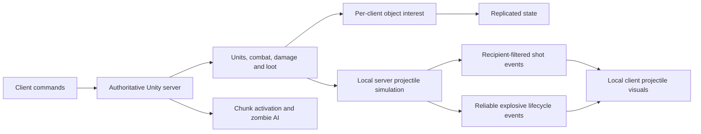

# Just Scavenge — Multiplayer Systems

A top-down co-op zombie survival prototype built in Unity. Deploy a survivor squad,
scavenge supplies, fight through the neighborhood, and bring progression home.

This portfolio explores the engineering behind that loop: server-owned combat,
selective replication, shared zombie navigation, and bounded spawning work.
The full Unity game remains private; these selected files are for architectural review.

## Gameplay

https://github.com/user-attachments/assets/2cb66ee2-95bf-4b0e-9161-4768dece1be6

Gameplay footage showing squad movement, combat, and enemy behavior; the source snapshot below identifies the published code.

## Snapshot and scope

**Source snapshot: October 28, 2026.** These samples reflect the local game's
working files, including changes that were not yet committed in the private
project. This is a source snapshot, not a claim that every change is in a shipped
client or hosted server.

The files are exported without rewriting their gameplay implementation.
[SOURCE_SNAPSHOT.json](SOURCE_SNAPSHOT.json) records their original paths,
LF-normalized SHA-256 hashes, source revision, and working-tree state.

**This is a code portfolio, not a standalone Unity project.** It omits scenes,
prefabs, ScriptableObject instances, art/audio, package setup, backend services,
and supporting game systems such as inventory, profiles, weapons, and status
effects. The selected scripts reference those dependencies and will not compile
as a complete game on their own. Deployment configuration is not included.

## What to explore

| Engineering area | Starting point | What the sample demonstrates |
|---|---|---|
| Authoritative combat | [Combat.cs](Combat/Combat.cs) | Server attack decisions, weapon state, and projectile launch data |
| Projectile replication | [ProjectilePool.cs](Combat/ProjectilePool.cs) | Local simulation with recipient-filtered visual event batches |
| Compact protocols | [ProjectileShotCodec.cs](Networking/ProjectileShotCodec.cs) | Versioned encoding, quantization, fallbacks, and strict decoding |
| Network interest | [NetworkInterestManager.cs](Networking/NetworkInterestManager.cs) | Per-client visibility around living squad members |
| Zombie simulation | [ZombieChunkManager.cs](Optimization/ZombieChunkManager.cs) | Activation, dormancy, snapshot restoration, and spawn eligibility |
| Shared navigation | [ZombieFlowFieldManager.cs](Optimization/ZombieFlowFieldManager.cs) | Shared horde directions over cached NavMesh topology |
| Spawn pacing | [ZombieSpawnScheduler.cs](Optimization/ZombieSpawnScheduler.cs) | A shared creation budget for fresh spawns and restoration |
| World loot | [LootSocketManager.cs](Loot/LootSocketManager.cs) | Weighted chunk activation and timed restocking |
| Server lifecycle | [ServerBootstrap.cs](Networking/ServerBootstrap.cs) | PlayFab allocation, NGO startup, scene selection, and shutdown |

## Architecture



The server resolves gameplay. Clients submit commands and present replicated
state and cosmetic events. Simulation activation and network visibility are
separate decisions: a zombie can remain active on the server while a particular
remote client receives no copy of it.

### Combat without a network object for every bullet

[Projectile.cs](Combat/Projectile.cs) is a local `MonoBehaviour` with authority
and visual-only modes. Server projectiles resolve hits, damage, piercing,
bouncing, and split children. Clients replay visual trajectories; those visual
collisions do not decide damage.

[ProjectilePool.cs](Combat/ProjectilePool.cs) sends ordinary shots through the
V2 compact codec with `UnreliableSequenced` delivery. Each packet carries its own
origin, so playback does not depend on a previous packet. Position, direction,
speed, and lifetime use compact representations where possible; explicit
fallbacks retain values that do not fit. Invalid batches are rejected before
partial playback.

[ProjectileInterestUtility.cs](Networking/ProjectileInterestUtility.cs) includes
potentially incoming trajectories when selecting recipients. Filtering happens
before the shared batch origin is encoded. Hidden ignored-target identifiers
are omitted for each recipient.

Explosive projectiles use a separate reliable launch/termination channel in
[ProjectilePool.Explosions.cs](Combat/ProjectilePool.Explosions.cs) and
[ExplosiveProjectileCodec.cs](Networking/ExplosiveProjectileCodec.cs).
[ExplosionResolver.cs](Combat/ExplosionResolver.cs) resolves server blast damage and cover;
[ExplosionPresentation.cs](Combat/ExplosionPresentation.cs) handles client blast effects.

[ProjectileVisualConfig.cs](Combat/ProjectileVisualConfig.cs) and its
[registry](Combat/ProjectileVisualRegistry.cs) select presentation independently
of gameplay. [ProjectileTrailPool.cs](Combat/ProjectileTrailPool.cs) lets trails
finish fading after bullets return to their pool. Authority projectiles do not
render, including when running as a host.

### Replicate the world each squad needs

[NetworkInterestManager.cs](Networking/NetworkInterestManager.cs) considers the
union of a client's living survivor areas. Separate entry and exit distances
reduce repeated hide/show at boundaries. Owned survivors remain visible to their
owner, private inventory follows an owner-only policy, and zombies and loot use
spatial visibility.

[Unit.cs](Unit/Unit.cs), [PlayerUnit.cs](Unit/PlayerUnit.cs), and
[Combat.cs](Combat/Combat.cs) separate public presentation from private state.
Ordinary cosmetic hit effects are compacted with
[HitEffectCodec.cs](Networking/HitEffectCodec.cs); lethal hit feedback travels
with reliable death state. Losing a cosmetic packet does not undo server damage.

### Activate nearby simulation and share navigation work

[ZombieChunkManager.cs](Optimization/ZombieChunkManager.cs) tracks active chunks
around living survivors. Dormant zombies stop AI and movement work. Fresh spawn
eligibility also excludes a configurable ring around every survivor, while
saved zombies can restore inside the active area.

[ZombieSpawnScheduler.cs](Optimization/ZombieSpawnScheduler.cs) shares a creation
and attempt budget between [spawners](Optimization/ZombieSpawner.cs) and snapshot
restoration. Idle zombies at the outer active ring use slower decisions; target
searches can be skipped when their detection reach cannot cross the minimum
chunk separation. Alerts and valid targets restore normal decision scheduling.

[ZombieFlowFieldManager.cs](Optimization/ZombieFlowFieldManager.cs) caches the
expensive NavMesh topology and rebuilds dynamic costs for shared horde movement.
Its flow-field eligibility check still scans propagation origins; it is not a
constant-time lookup.

[ZombieSyncManager.cs](Optimization/ZombieSyncManager.cs) now preserves existing
scene references by creating the chunk and flow-field managers. The former
three-tier distance LOD system is no longer its implementation.

### Loot can restock while players stay nearby

[LootSocketManager.cs](Loot/LootSocketManager.cs) selects weighted sockets per
active chunk and tracks depletion with chunk-level timestamps. Depleted active
chunks can refill once their timer expires, including occupied chunks. Inactive
chunks keep their timestamp and refill when activated if due.
[LootContainer.cs](Loot/LootContainer.cs) also maintains a server-owned looting
lock so two units cannot process the same container concurrently.

Chunk activation controls simulation and loot availability. It does **not**
stream map geometry out of memory.

## Technology and tuning

The source project uses Unity **6000.4.4f1**, Universal Render Pipeline **17.4.0**,
Netcode for GameObjects **2.11.0**, AI Navigation **2.0.12**, and the Input System.
Its online infrastructure uses PlayFab authentication and Multiplayer Servers,
the PlayFab GSDK, Azure Functions, and Linux server containers. This repository
includes the Unity server lifecycle samples, not the complete service stack.

See [current tuning](docs/current-tuning.md) for the serialized settings behind
this snapshot. Unity assets can override C# field initializers, so the scripts'
defaults alone do not establish effective gameplay values.

No reproducible performance benchmark accompanies this snapshot. Live latency,
packet loss, and large-horde performance require testing with matching
client/server builds and representative scenes.

## Check the exported snapshot

Run the verifier from this repository with Python 3:
```sh
python tools/verify_snapshot.py
```

It checks published samples against the manifest after normalizing line endings.
With access to the source project, also compare the original files:
```sh
python tools/verify_snapshot.py --source-root "path/to/source/project"
```

Hash agreement verifies the export's identity; it does not compile the omitted Unity project or validate a multiplayer release.

## License

Published source is licensed under [GPL-3.0](LICENSE).
